  <picture>
    <source media="(prefers-color-scheme: dark)" srcset="assets/banner-dark.svg">
    <source media="(prefers-color-scheme: light)" srcset="assets/banner-light-v2.svg">
    
  </picture>

I'm Tomek, 19, from Poland. I've been building for the web for about a year, mostly with HTML, CSS and JavaScript. Most of what I know comes from co-creating FragHub.

I recently started learning React, Next.js and Tailwind, and I work with AI coding assistants as part of my web dev workflow.

Open to work.

### Projects

**[FragHub](https://hub.fragujemy.com)** – website for the Fragujemy CS servers: rankings, bans, bug reports, forum. PHP, JS. Private repo.

**[Steam Group Tags](https://github.com/tomsoniik/Steam-Group-Chrome-Extention)** – browser extension for Steam groups: tags next to names, one-click join, duplicate finder, bulk leave. JavaScript.

**[Untmatica](https://github.com/tomsoniik/planturned)** – Unturned base planner, 2D editor + 3D walkthrough. Next.js, TypeScript. [Demo](https://base-planner-unturned.vercel.app)

**[AutoMessageChat](https://github.com/tomsoniik/AutoMessageChat)** – CS2 plugin for chat messages. C#.

### Stack

**Day to day** 

**Learning now** 

**Also worked with** 

### Contact

Discord: `tomsoncs`

 

<picture>
  <source media="(prefers-color-scheme: dark)" srcset="https://raw.githubusercontent.com/tomsoniik/tomsoniik/output/github-contribution-grid-snake-dark.svg">
  <source media="(prefers-color-scheme: light)" srcset="https://raw.githubusercontent.com/tomsoniik/tomsoniik/output/github-contribution-grid-snake.svg">
  
</picture>
