  <picture>
    <source media="(prefers-color-scheme: dark)" srcset="assets/banner.svg">
    <source media="(prefers-color-scheme: light)" srcset="assets/banner-light.svg">
    
  </picture>

Tomson, full-stack dev from Poland. Most of what I build is for gaming communities, Counter-Strike and Unturned mostly. Looking for a full-stack job.

### What I'm working on

**[FragHub](https://hub.fragujemy.com)** is the website for the Fragujemy CS servers (1.6, CS:GO, CS2). Rankings, ban lists, bug reports and the forum all in one place. PHP + JS. Live, still in development, repo is private.

**[Untmatica](https://github.com/tomsoniik/planturned)** is a base planner for Unturned. You lay out the base in 2D, then walk around it in 3D on the real game maps. Next.js, TypeScript, Python for pulling the game data. Try it here: [base-planner-unturned.vercel.app](https://base-planner-unturned.vercel.app)

**[AutoMessageChat](https://github.com/tomsoniik/AutoMessageChat)** is a small CS2 plugin in C# (CounterStrikeSharp). Rotating chat messages and a welcome message when someone joins.

### Stack

### Contact

Discord: `tomsoncs`

 

<picture>
  <source media="(prefers-color-scheme: dark)" srcset="https://raw.githubusercontent.com/tomsoniik/tomsoniik/output/github-contribution-grid-snake-dark.svg">
  <source media="(prefers-color-scheme: light)" srcset="https://raw.githubusercontent.com/tomsoniik/tomsoniik/output/github-contribution-grid-snake.svg">
  
</picture>
